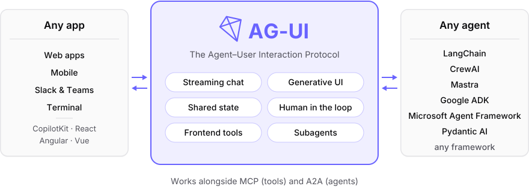
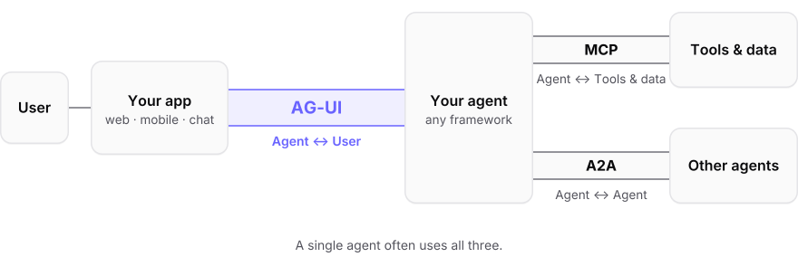
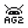

<div align="center">

<a href="https://docs.ag-ui.com"></a>

### 连接任意 Agent 与任意应用的开源协议。

<a href="https://www.npmjs.com/package/@ag-ui/core"></a>
<a href="https://www.npmjs.com/package/@ag-ui/core"></a>
<a href="https://pypi.org/project/ag-ui-protocol/"></a>
<a href="https://discord.gg/Jd3FzfdJa8"></a>
<a href="LICENSE"></a>

**[文档](https://docs.ag-ui.com)** · **[示例](https://dojo.ag-ui.com)** · **[规范](https://docs.ag-ui.com/spec/1.0)** · **[Discord](https://discord.gg/Jd3FzfdJa8)**

<a href="https://docs.ag-ui.com/talk-to-us"></a>

<a href="https://trendshift.io/repositories/27961?utm_source=repository-badge&utm_medium=badge&utm_campaign=badge-repository-27961"></a>

</div>

<br>

**AG-UI 是一个开放、轻量、基于事件的协议，标准化 AI Agent 与面向用户应用的连接方式。**

Agent 不适合请求/响应模型。它们流式输出 token、在响应中途调用工具、更新共享状态、暂停等待人工介入、派生子 Agent，而每个框架的做法都不一样。AG-UI 用一条双向事件流取代这些自定义接线：Agent 发出类型化事件，任何客户端都能渲染，无论 Agent 由哪个框架构建。同一个 Agent 可以驱动 Web 应用、移动应用、终端或 Slack。

<a href="https://docs.ag-ui.com"></a>

> [!IMPORTANT]
> **AG-UI 1.0 已发布。** 协议现在有了稳定、冻结的[规范](https://docs.ag-ui.com/spec/1.0)，由 JSON Schema 支撑，TypeScript、Python 和 .NET SDK 均由其生成。1.0 双向向后兼容：0.x Agent 可与 1.0 客户端配合，反之亦然。[变更内容 →](https://docs.ag-ui.com/spec/1.0/changelog) · [迁移指南 →](https://docs.ag-ui.com/migrating-to-1-0)

## 快速开始

**创建新应用。** CLI 会搭建一个前端（Next.js 上的 [CopilotKit](https://github.com/CopilotKit/CopilotKit)，或终端客户端），并接入你选择的 Agent 框架：

```bash
npx create-ag-ui-app@latest
```

然后按打印出的后续步骤操作。生成的模板会调用 OpenAI，因此在 `npm run dev` 前设置密钥：

```bash
export OPENAI_API_KEY="sk-..."
```

<details>
<summary><b>或直接使用协议：30 行的 Agent 服务端与客户端</b></summary>
<br>

AG-UI Agent 是任何接受 `RunAgentInput` 并流式返回事件的 HTTP 端点。这个示例不需要 API 密钥。

**1. Agent（Python）。** 需要 Python 3.9+。

```bash
pip install ag-ui-protocol fastapi uvicorn
```

```python
# server.py
import uuid

from fastapi import FastAPI, Request
from fastapi.responses import StreamingResponse
from ag_ui.core import (
    PROTOCOL_VERSION,
    RunAgentInput,
    RunStartedEvent,
    RunFinishedEvent,
    TextMessageStartEvent,
    TextMessageContentEvent,
    TextMessageEndEvent,
)
from ag_ui.encoder import EventEncoder

app = FastAPI()

@app.post("/")
async def run_agent(input_data: RunAgentInput, request: Request):
    encoder = EventEncoder(accept=request.headers.get("accept"))

    async def events():
        yield encoder.encode(RunStartedEvent(
            thread_id=input_data.thread_id,
            run_id=input_data.run_id,
            protocol_version=PROTOCOL_VERSION,
        ))
        message_id = str(uuid.uuid4())
        yield encoder.encode(TextMessageStartEvent(message_id=message_id, role="assistant"))
        for chunk in ["Hello ", "from ", "AG-UI!"]:
            yield encoder.encode(TextMessageContentEvent(message_id=message_id, delta=chunk))
        yield encoder.encode(TextMessageEndEvent(message_id=message_id))
        yield encoder.encode(RunFinishedEvent(thread_id=input_data.thread_id, run_id=input_data.run_id))

    return StreamingResponse(events(), media_type=encoder.get_content_type())
```

```bash
uvicorn server:app --port 8000
```

**2. 客户端（TypeScript）。** 在第二个终端、新文件夹中操作。需要 Node.js 20+。

```bash
npm init -y && npm pkg set type=module
npm install @ag-ui/client tsx
```

```ts
// client.ts
import { HttpAgent } from "@ag-ui/client";

const agent = new HttpAgent({ url: "http://localhost:8000/" });

agent.addMessage({ id: crypto.randomUUID(), role: "user", content: "Hi there!" });

await agent.runAgent({}, {
  onRunStartedEvent: ({ event }) => console.log(`run started (AG-UI ${event.protocolVersion})`),
  onTextMessageContentEvent: ({ event }) => { process.stdout.write(event.delta); },
  onRunFinishedEvent: () => console.log("\nrun finished"),
});
```

```bash
npx tsx client.ts
```

你应该会看到 `Hello from AG-UI!` 流式输出。把服务端换成任意[支持的框架](#integrations)，客户端无需改动。

</details>

## AG-UI 的定位



AG-UI 是三个开放、互补的 Agent 协议之一。**MCP** 为 Agent 提供工具和上下文，**A2A** 让 Agent 与其他 Agent 协作，**AG-UI** 将 Agent 带给用户。单个 Agent 通常三者兼用，AG-UI 也可以作为支持 MCP 或 A2A 的 Agent 的前端。[了解更多 →](https://docs.ag-ui.com/agentic-protocols)

> [!NOTE]
> **AG-UI 还是 A2UI？** 两者协同工作。[A2UI](https://github.com/google/A2UI)、MCP Apps 和 Open-JSON-UI 是*生成式 UI 规范*：它们描述 Agent 想展示什么 UI。AG-UI 是*运行时协议*，负责在 Agent 和应用之间传输这些载荷及其他所有内容。[了解更多 →](https://docs.ag-ui.com/concepts/generative-ui-specs)

## 集成

AG-UI 已被 Google、Microsoft、Amazon 和 Oracle 采用，并内置于大多数 Agent 框架。以下每个框架在 [Dojo](https://dojo.ag-ui.com) 中都有在线演示。

<table>
  <tr>
    <td align="center" valign="top" width="25%"><br><b>LangChain</b><br><sub><a href="https://docs.copilotkit.ai/langgraph/">文档</a> · <a href="https://dojo.ag-ui.com/langgraph-fastapi/feature/agentic_chat">演示</a></sub></td>
    <td align="center" valign="top" width="25%"><br><b>CrewAI</b><br><sub><a href="https://docs.copilotkit.ai/crewai-flows">文档</a> · <a href="https://dojo.ag-ui.com/crewai/feature/agentic_chat">演示</a></sub></td>
    <td align="center" valign="top" width="25%"><br><b>Microsoft Agent Framework</b><br><sub><a href="https://docs.copilotkit.ai/microsoft-agent-framework">文档</a> · <a href="https://dojo.ag-ui.com/microsoft-agent-framework-python/feature/agentic_chat">演示</a></sub></td>
    <td align="center" valign="top" width="25%"><br><b>Google ADK</b><br><sub><a href="https://docs.copilotkit.ai/adk">文档</a> · <a href="https://dojo.ag-ui.com/adk-middleware/feature/agentic_chat">演示</a></sub></td>
  </tr>
  <tr>
    <td align="center" valign="top" width="25%"><br><b>AWS Strands Agents</b><br><sub><a href="https://docs.copilotkit.ai/aws-strands">文档</a> · <a href="https://dojo.ag-ui.com/aws-strands/feature/agentic_chat">演示</a></sub></td>
    <td align="center" valign="top" width="25%"><br><b>Mastra</b><br><sub><a href="https://docs.copilotkit.ai/mastra/">文档</a> · <a href="https://dojo.ag-ui.com/mastra/feature/agentic_chat">演示</a></sub></td>
    <td align="center" valign="top" width="25%"><br><b>Pydantic AI</b><br><sub><a href="https://docs.copilotkit.ai/pydantic-ai/">文档</a> · <a href="https://dojo.ag-ui.com/pydantic-ai/feature/agentic_chat">演示</a></sub></td>
    <td align="center" valign="top" width="25%"><br><b>LlamaIndex</b><br><sub><a href="https://docs.copilotkit.ai/llamaindex/">文档</a> · <a href="https://dojo.ag-ui.com/llama-index/feature/agentic_chat">演示</a></sub></td>
  </tr>
  <tr>
    <td align="center" valign="top" width="25%"><br><b>Agno</b><br><sub><a href="https://docs.copilotkit.ai/agno/">文档</a> · <a href="https://dojo.ag-ui.com/agno/feature/agentic_chat">演示</a></sub></td>
    <td align="center" valign="top" width="25%"><br><b>AG2</b><br><sub><a href="https://docs.copilotkit.ai/ag2/">文档</a> · <a href="https://dojo.ag-ui.com/ag2/feature/agentic_chat">演示</a></sub></td>
    <td align="center" valign="top" width="25%"><br><b>Claude Agent SDK</b><br><sub><a href="integrations/claude-agent-sdk">文档</a> · <a href="https://dojo.ag-ui.com/claude-agent-sdk-python/feature/agentic_chat">演示</a></sub></td>
    <td align="center" valign="top" width="25%"><br><b><a href="https://docs.ag-ui.com/integrations">+11 更多</a></b><br><sub>Antigravity、OpenAI Agents、watsonx、Spring AI 等见<a href="#full-list-of-integrations">完整列表</a></sub></td>
  </tr>
</table>

**协议：** [A2A](https://docs.copilotkit.ai/a2a-protocol) · [MCP](middlewares/mcp-middleware) · [MCP Apps](https://docs.copilotkit.ai/generative-ui-specs/mcp-apps) · [A2UI](middlewares/a2ui-middleware)\
**客户端：** [CopilotKit](https://github.com/CopilotKit/CopilotKit)（React、Angular、Vue、React Native） · [Slack 和 Teams](https://github.com/CopilotKit/channels-sdk) · [终端](https://docs.ag-ui.com/quickstart/clients) · [OpenBot](https://open.bot/builders)

没有你的框架？[构建集成 →](https://docs.ag-ui.com/quickstart/introduction)

### 完整集成列表

<details>
<summary><b>显示所有集成</b></summary>
<br>

- **合作伙伴：** [LangChain](https://docs.copilotkit.ai/langgraph/) · [CrewAI](https://docs.copilotkit.ai/crewai-flows)
- **内置：** [Microsoft Agent Framework](https://docs.copilotkit.ai/microsoft-agent-framework) · [Google ADK](https://docs.copilotkit.ai/adk)（[JS](https://docs.ag-ui.com/integrations/google-adk-js)） · [Google Antigravity](https://docs.copilotkit.ai/google-antigravity) · [AWS Strands Agents](https://docs.copilotkit.ai/aws-strands) · [Mastra](https://docs.copilotkit.ai/mastra/) · [Pydantic AI](https://docs.copilotkit.ai/pydantic-ai/) · [Agno](https://docs.copilotkit.ai/agno/) · [LlamaIndex](https://docs.copilotkit.ai/llamaindex/) · [AG2](https://docs.copilotkit.ai/ag2/)
- **更多框架：** [Claude Agent SDK](integrations/claude-agent-sdk) · [Claude Managed Agents](integrations/claude-managed-agents) · [IBM watsonx Orchestrate](integrations/watsonx) · [Langroid](integrations/langroid) · [Spring AI](integrations/community/spring-ai) · [Cloudflare Agents](integrations/community/cloudflare-agents) · [Omnara](https://docs.ag-ui.com/integrations/omnara) · [Genkit (Go)](integrations/community/genkit/go) · [OpenAI Agents](integrations/openai-agents)
- **规范：** [Oracle Agent Spec](https://go.copilotkit.ai/copilotkit-oracle-docs)
- **部署：** [Amazon Bedrock AgentCore](https://docs.aws.amazon.com/bedrock-agentcore/latest/devguide/runtime-agui.html)

每个集成的源码位于 [`integrations/`](integrations) 和 [`middlewares/`](middlewares)，演示位于 [`apps/dojo`](apps/dojo)。

</details>

## SDK

| 语言 | 安装 | 参考 |
| --- | --- | --- |
| **TypeScript** | `npm install @ag-ui/client` | [文档](https://docs.ag-ui.com/sdk/js/core/overview)